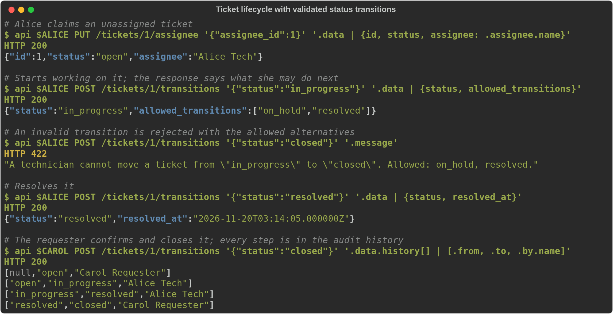
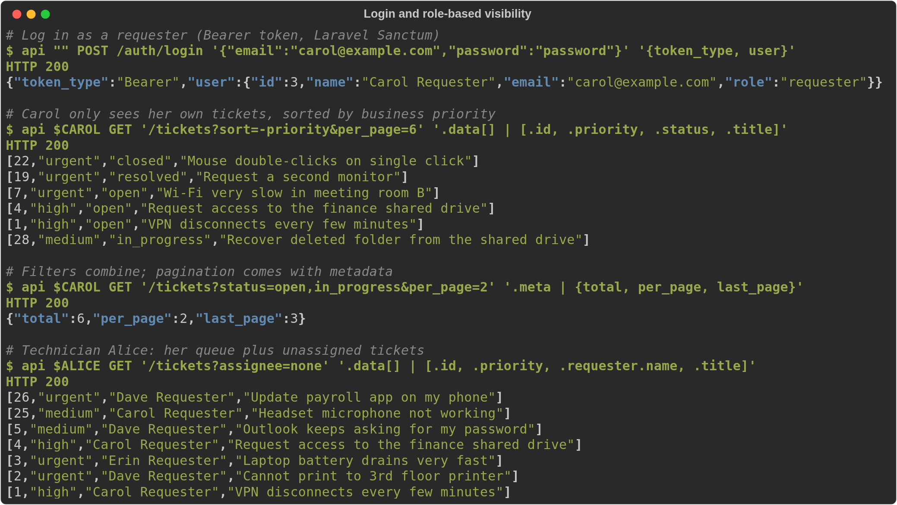
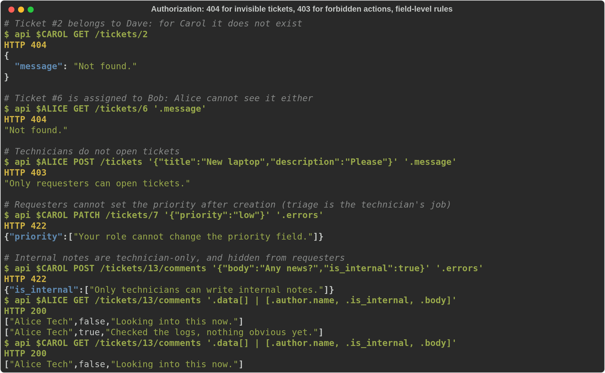
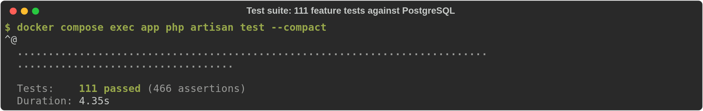
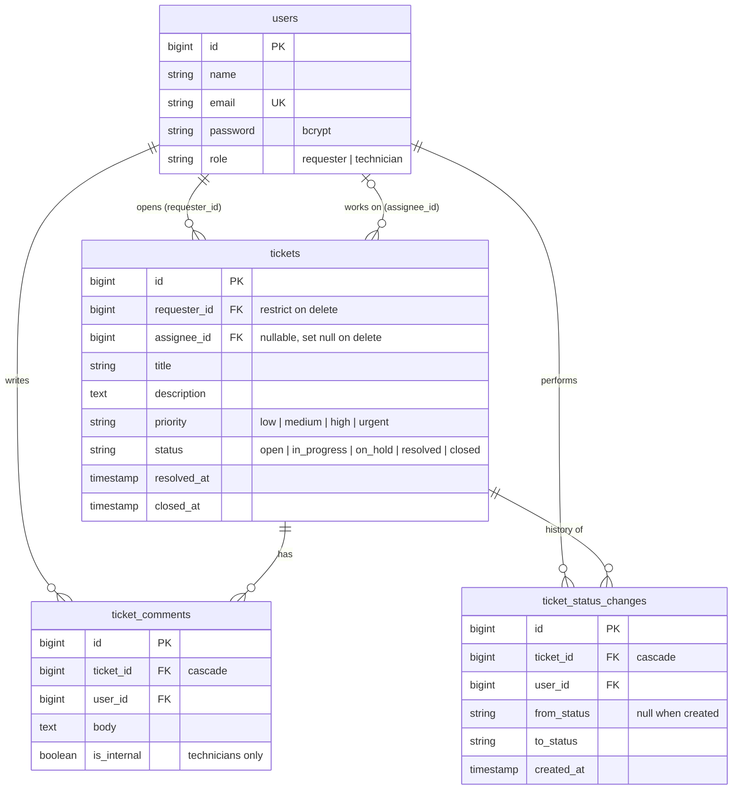
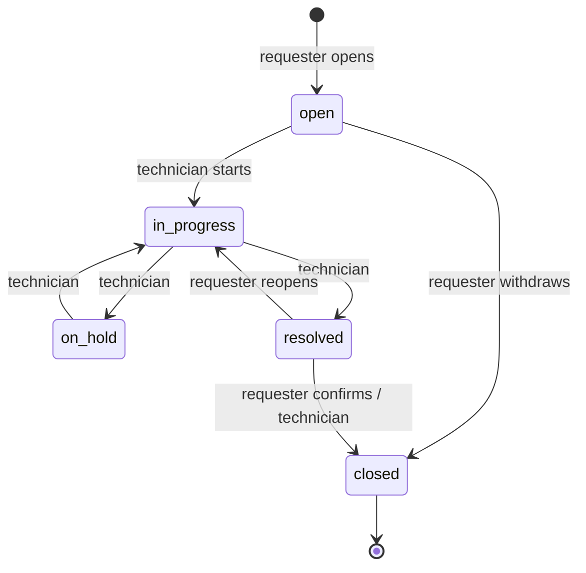

# Support Tickets API

[](https://github.com/lucianorichard/support-tickets-api/actions/workflows/ci.yml)


A REST API for an IT support desk: **requesters** open tickets, **technicians** pick them up
and work them to resolution. Built with Laravel 13 and PostgreSQL to show backend
fundamentals: authentication, role-based and row-level authorization, a validated status
workflow, relational data modelling, filtering with pagination, and tests that pin all of it down.

The scope is intentionally small: no chat, attachments, payments or multi-tenancy.



## Highlights

- **Two roles with different views of the data.** Requesters only ever see their own
  tickets; technicians see their assigned work plus the unassigned queue.
- **Status workflow as a state machine.** One transition table defines which status changes
  exist and who may perform each; anything else is rejected with the allowed alternatives.
- **Concurrency-safe changes.** Transitions and assignments lock the ticket row
  (`SELECT ... FOR UPDATE`), so two technicians cannot claim the same ticket at once.
- **Audit trail.** Every status change is recorded with its author and time.
- **No information leaks.** Another user's ticket is a `404`, never a `403`.
- **111 feature tests on real PostgreSQL**, including all 75 combinations of
  status x target status x actor.
- **One command to run**: `docker compose up` builds the API (FrankenPHP), starts
  PostgreSQL, migrates and loads demo data.

## Quick start

Requirements: Docker with Compose.

```bash
git clone https://github.com/lucianorichard/support-tickets-api.git
cd support-tickets-api
docker compose up -d --build --wait
curl http://localhost:8080/api
```

The API is on `http://localhost:8080/api` (change it with `APP_PORT=9000 docker compose up`).
Demo data is loaded on first start. All accounts use the password `password`:

| Email | Role |
| --- | --- |
| `alice@example.com`, `bob@example.com` | technician |
| `carol@example.com`, `dave@example.com`, `erin@example.com` | requester |

Run the tests (they use a separate `tickets_test` database and never touch the demo data):

```bash
docker compose exec app php artisan test
```

Reset everything: `docker compose down -v && docker compose up -d --build --wait`.

## Usage examples

```bash
API=http://localhost:8080/api
TOKEN=$(curl -s $API/auth/login -H 'Content-Type: application/json' \
  -d '{"email":"carol@example.com","password":"password"}' | jq -r .token)

# My open and in-progress tickets, most urgent first, 10 per page
curl -s "$API/tickets?status=open,in_progress&sort=-priority&per_page=10" \
  -H "Authorization: Bearer $TOKEN" -H 'Accept: application/json'

# Open a ticket
curl -s $API/tickets -H "Authorization: Bearer $TOKEN" -H 'Content-Type: application/json' \
  -d '{"title":"VPN disconnects every few minutes","description":"Since this morning...","priority":"high"}'

# Confirm a resolved ticket
curl -s $API/tickets/19/transitions -H "Authorization: Bearer $TOKEN" -H 'Content-Type: application/json' \
  -d '{"status":"closed"}'
```

Full reference with request and response examples: **[docs/API.md](docs/API.md)**.

| Method | Endpoint | Who |
| --- | --- | --- |
| `POST` | `/auth/register`, `/auth/login` | anyone (rate limited) |
| `POST` | `/auth/logout` · `GET /me` | authenticated |
| `GET` | `/tickets` (filters, sorting, pagination) | authenticated |
| `POST` | `/tickets` | requester |
| `GET` / `PATCH` | `/tickets/{id}` | owner / assignee |
| `POST` | `/tickets/{id}/transitions` | owner / assignee |
| `PUT` | `/tickets/{id}/assignee` | technician |
| `GET` / `POST` | `/tickets/{id}/comments` | owner / assignee |
| `GET` | `/technicians` | technician |

## Screenshots

Real sessions against the demo data (`api` is a small curl + jq helper).

**Login and role-based visibility**



**Authorization: 404 for invisible tickets, 403 for forbidden actions, field-level rules**



**Test suite**



## Data model



- **Roles, priorities and statuses are strings with `CHECK` constraints**, mapped to PHP
  enums. The database rejects unknown values even if application code has a bug, and
  adding a value later is a simple migration (native PostgreSQL `ENUM` types are awkward
  to alter).
- **Indexes follow the two hot queries**: `(requester_id, status)` for "my tickets" and
  `(assignee_id, status)` for a technician's queue.
- **Foreign keys encode retention rules**: a user with tickets cannot be deleted (support
  history must survive); deleting a ticket removes its comments and history.
- **`ticket_status_changes` is append-only**: no `updated_at`, written only by the workflow.

## Ticket lifecycle



Technicians can only change the status of tickets assigned to them. Resolving sets
`resolved_at`, reopening clears it, closing sets `closed_at`. Closed tickets are frozen: no
edits, comments or reassignment.

## Permissions

| Action | Requester | Technician |
| --- | --- | --- |
| See tickets | Own tickets | Assigned to them + unassigned queue |
| Open a ticket | Yes | No |
| Edit title / description | Own, while `open` | No |
| Change priority | Only when opening | Assigned, until closed |
| Change status | Own: withdraw, confirm, reopen | Assigned: start, hold, resolve, close |
| Assign | No | Claim unassigned; hand over own |
| Comment | Own tickets | Visible tickets, plus internal notes |
| See internal notes | No | Yes |

## Technical decisions

- **Sanctum personal access tokens.** Simple bearer tokens for a pure API; tokens are
  stored hashed and revoked on logout. Public registration only creates requesters, and
  `role` is not mass-assignable, so nobody can self-promote to technician.
- **Visibility at the query level, permissions in a policy.** `Ticket::scopeVisibleTo()` is
  used both for listings and for resolving `{ticket}` in the URL, so a ticket outside your
  scope is a 404 everywhere and cannot be forgotten in a new endpoint. `TicketPolicy` then
  decides what you may do with a ticket you can see, with explicit reasons.
- **Authorization before validation.** Form requests authorize first, so a forbidden user
  gets `403`, never validation messages that describe the resource.
- **Workflow in one service.** `TicketWorkflow` is the only code that changes status or
  assignee. The transition table lives in the `TicketStatus` enum, and the API returns
  `allowed_transitions` for the current user so clients never duplicate the rules.
- **Row locks for state changes.** Each change re-reads the ticket `FOR UPDATE` inside a
  transaction and re-checks the assignee, closing the gap between the policy check and the write.
- **Business-aware sorting and safe search.** Priority sorts by weight (urgent first), not
  alphabetically; `id` is a tie-breaker so pagination is stable; search uses `ILIKE` with
  the user's `%` and `_` escaped.
- **No leaky errors.** Wrong password and unknown email return the same message; 404 bodies
  never name internal classes; login and registration are rate limited.
- **Tests on PostgreSQL, not SQLite.** The suite exercises the real `ILIKE`, `CHECK`
  constraints and locking. A guard refuses to run it against any database whose name does
  not end in `_test`.
- **Specification-style lifecycle test.** The allowed transitions are written out by hand in
  the test, independently of the enum, and all 75 combinations are checked.
- **FrankenPHP in Docker.** A production-grade server in a single container, instead of
  `artisan serve`, which handles one request at a time.
- **Deterministic demo data.** The seeder drives every ticket through `TicketWorkflow` with a
  fixed seed, so the history is realistic and the data is the same on every machine.

## Project structure

```text
app/
  Enums/                 Role, TicketPriority, TicketStatus (with the transition table)
  Services/TicketWorkflow.php   status changes and assignment, with row locks
  Policies/TicketPolicy.php     who may do what
  Models/                User, Ticket (visibility scope), TicketComment, TicketStatusChange
  Http/Controllers/Api/  thin controllers
  Http/Requests/         authorization + validation per endpoint
  Http/Resources/        JSON shape of every response
database/migrations/     schema with CHECK constraints and indexes
database/seeders/        deterministic demo data driven through the workflow
tests/Feature/           auth, authorization, lifecycle, listing
docs/API.md              endpoint reference
```

## Limitations and next steps

- No notifications (email or webhooks) when a ticket changes.
- No administrator role: technicians are created through seeding, not the API.
- Assignment changes are not part of the audit trail yet; only status changes are.
- Search covers titles only; full-text search over descriptions and comments would use
  PostgreSQL `tsvector`.
- The Docker setup targets local development and demos (debug on, generated app key).

## License

[MIT](LICENSE)
